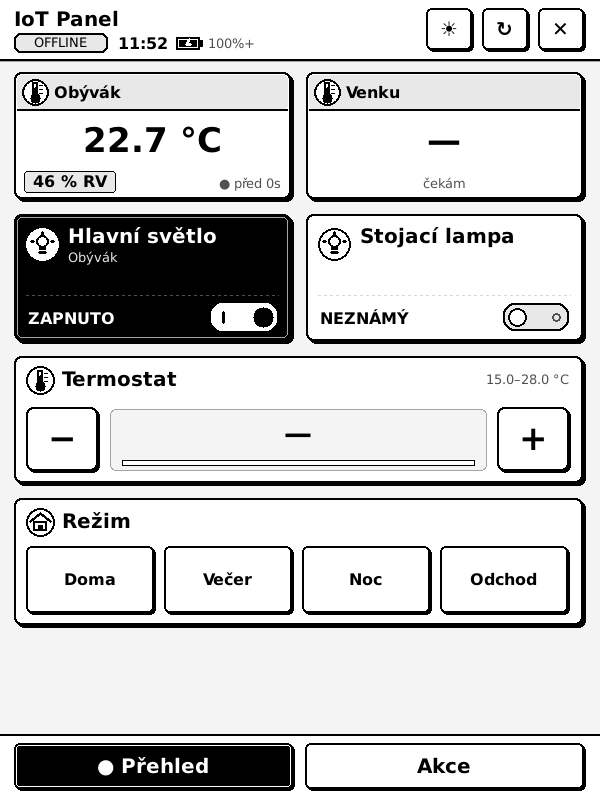
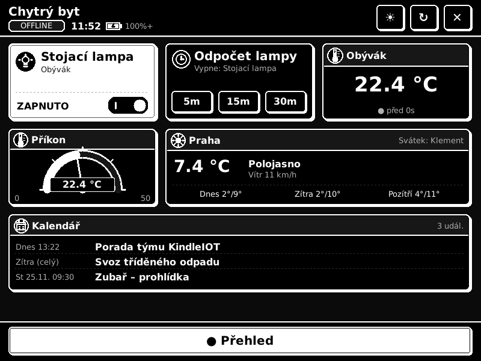
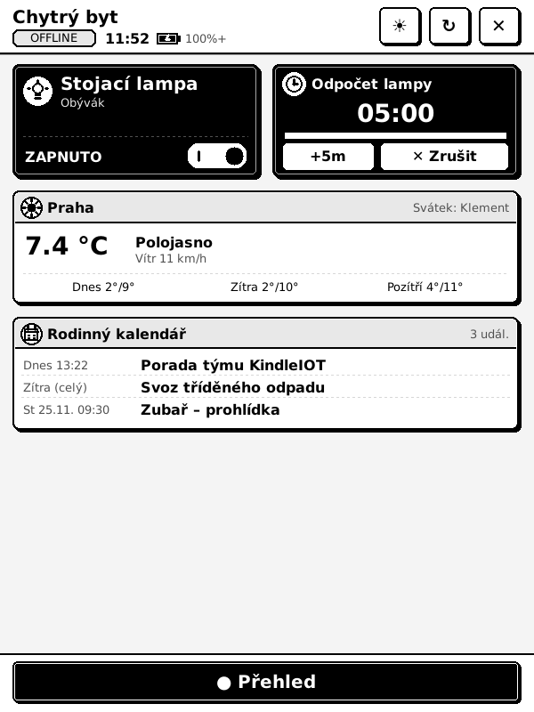
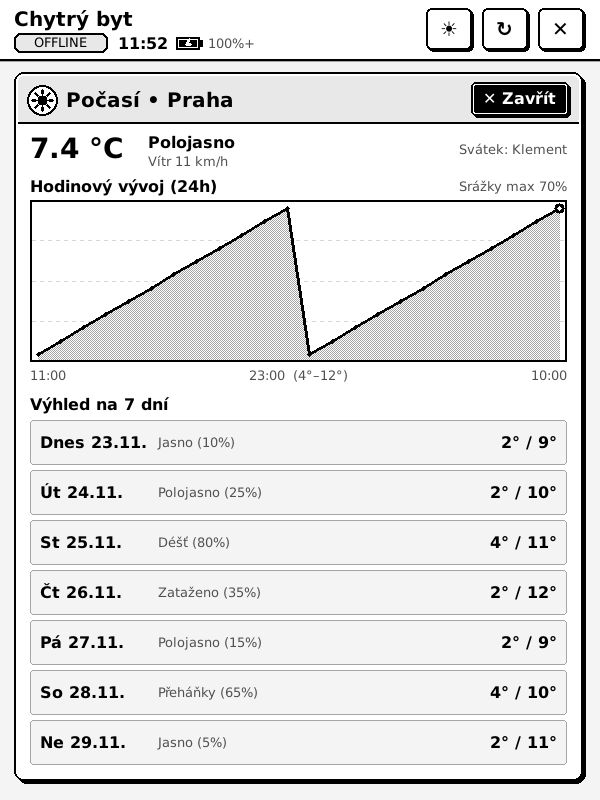
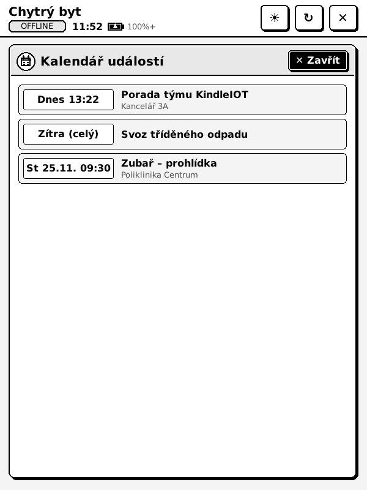
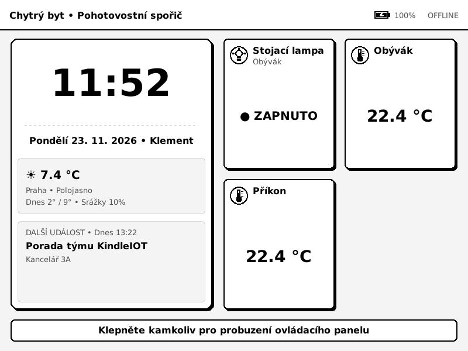
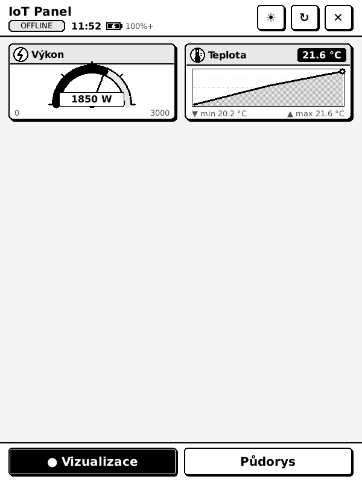
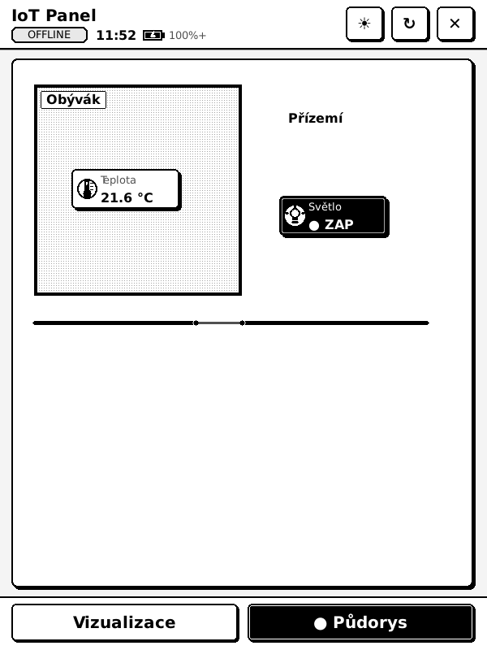
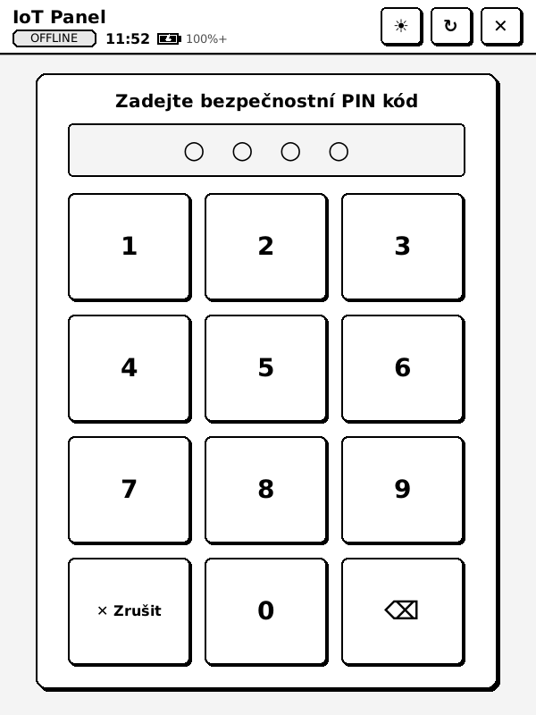

# KindleIOT

**Proměňte jailbreaknutý Amazon Kindle v nástěnný e-ink ovládací panel chytré domácnosti — nativní MQTT klient, vestavěný Apple HomeKit bridge, počasí, iCal kalendář, časovače a vizuální webový editor bez externích závislostí.**

[](https://github.com/Chameloun/KindleIOT/actions/workflows/ci.yml)
[](LICENSE)
[](go.mod)
[](docs/DEPLOYMENT.md)

[🇬🇧 English](README.md) · [🇨🇿 Česky](README.cs.md)

---

## Ukázky obrazovek

| Hlavní panel (na výšku) | Režim na šířku + Dark Mode (3 sloupce) | Časovač a Kalendář |
| :---: | :---: | :---: |
|  |  |  |

| 7denní a 24h detail počasí | Detail událostí kalendáře | Spořič Standby na šířku |
| :---: | :---: | :---: |
|  |  |  |

| Budíky a grafy | Interaktivní půdorys bytu | Zámek PIN kódem |
| :---: | :---: | :---: |
|  |  |  |

---

## Hlavní funkce

- **Čistá statická Go binárka (`CGO_ENABLED=0`, `armhf`)** — Nulové externí knihovny nebo runtime závislosti. Kreslí přímo do X11 okna Kindle Awesome WM (`600×800` na výšku nebo softwarově otočených `800×600` na šířku) s vysokým e-ink kontrastem, 2×2 ditheringem a automatickým plným flashem proti ghostingu.
- **Univerzální MQTT i více brokerů současně** — `tcp://`, `mqtt://`, `ssl://`, `mqtts://`, `wss://` (včetně HiveMQ Cloud díky vestavěným kořenovým certifikátům), LWT (`<base_topic>/status`), automatické znovupřipojení, JSONPath extrakce (`$.temperature`, `$.state`, `$.readings[0].val`) pro Zigbee2MQTT / Tasmotu / Shelly / ESPHome i volitelné **Home Assistant MQTT Discovery**.
- **Vestavěný Apple HomeKit Bridge (HAP)** — Zpřístupněte vybrané vypínače (`lightbulb`, `switch`, `outlet`) a teplotní senzory přímo do aplikace **Domácnost** na iPhonu/iPadu (`udp/5353` mDNS + `tcp/51827`). Funguje i čistě lokálně bez externího MQTT brokeru (`local/switch/<id>`).
- **10 typů karet + interaktivní půdorys budovy** — `switch`, `button` (jednorázový příkaz nebo vícekroková makro scéna s volitelným dvoukrokovým potvrzením), `stepper` (`−` / `+` pro termostat či žaluzie), `sensor` (hlavní + sekundární hodnota, mapování textů, min/max alarmy, indikace starých dat), `gauge` (obloukový budík), `chart` (graf vývoje), `select`, `weather`, `timer`, `calendar` a editor půdorysů (`floorplan`) s místnostmi, zdmi, dveřmi a interaktivními body.
- **Počasí Open-Meteo, české svátky a kalendář `.ics`** — Aktuální počasí a české jmeniny bez API klíče s rozklikávacím 24hodinovým grafem a 7denní předpovědí; čtečka iCal (`.ics` / `webcal://` pro Google Kalendář a Apple iCloud) včetně týdenních a ročních opakování (`RRULE`).
- **Časovače (Minutky) a Denní plány** — Rychlé odpočty (`5m / 15m / 30m`, `+5m`, `✕ Zrušit`), které po vypršení probudí displej a přepnou zvolené světlo nebo pošlou MQTT zprávu, plus opakované automatizace v zadaný čas a dny v týdnu (`schedules`).
- **Spořič, podsvícení, Tmavý režim a PIN pojistka** — Časovač zhasnutí podsvícení (`backlight_timeout_sec`), automatický noční jas, pohotovostní spořič (`standby_timeout_sec`) s hodinami, datem, počasím, další událostí a 4 hlavními kartami, režimy zobrazení (`light`, `dark`, `auto_night`), alarmy překročení limitů a dětská pojistka s 4–8místným PINem.
- **Vestavěný webový editor a zrcadlení (`:8080`)** — V prohlížeči na PC či mobilu na adrese `http://<IP-Kindlu>:8080` najdete drag-and-drop návrhář obrazovky, kreslič půdorysů, živý klikatelný náhled displeje, inspektor MQTT zpráv, správu denních plánů a přímý YAML editor.

---

## Rychlý start

### Varianta A: Hotové vydání (GitHub Releases) na jailbreaknutý Kindle
1. Připravte si jailbreaknutý Kindle se stackem **KPM / Scriptlets (`hdnext`)** (ověřeno na **Kindle 10th Gen / KT4**, firmware `5.18.1.1.1`). Podrobnosti jsou v [návodu nasazení](docs/DEPLOYMENT.md).
2. Stáhněte archiv `kindleiot-*-kindle-armhf.zip` ze sekce [GitHub Releases](https://github.com/Chameloun/KindleIOT/releases).
3. Připojte Kindle přes USB a rozbalte obsah archivu do kořenového adresáře USB disku Kindlu:
   - `kindleiot/kindleiot-arm`
   - `kindleiot/start.sh`
   - Zkopírujte `kindleiot/config.example.yaml` jako `kindleiot/config.yaml` a případně upravte `mqtt.broker` (lze upravit i později z prohlížeče).
   - `documents/KindleIOT.sh`
4. Bezpečně odpojte USB a v knihovně Kindlu klepněte na položku **KindleIOT**.
5. Na počítači nebo mobilu ve stejné Wi-Fi otevřete `http://<IP-Kindlu>:8080`.

### Varianta B: Sestavení ze zdrojáků a nahrání přes USB
```bash
git clone https://github.com/Chameloun/KindleIOT.git
cd KindleIOT

# Sestaví ARMv7 binárku a nakopíruje vše na připojený Kindle (/run/media/$USER/Kindle)
make deploy-usb
```

### Varianta C: Spuštění a testování přímo na PC (bez Kindlu)
```bash
cp config.example.yaml config.yaml
make build-local

# Headless režim pouze s webovým simulátorem na http://localhost:8080
./kindleiot -config config.yaml -headless

# Nebo včetně desktopového X11 okna vedle webového editoru
./kindleiot -config config.yaml
```

---

## Dokumentace

- [Instalace a nasazení na Kindle](docs/DEPLOYMENT.md) — Jailbreak, struktura souborů na Kindlu, `start.sh` (`GODEBUG`, firewall, Wi-Fi), párování s Apple Home a diagnostika.
- [Kompletní referenční příručka konfigurace (`config.yaml`)](docs/CONFIGURATION.md) — Popis všech sekcí, všech 10 typů prvků, maker, časovačů, plánovačů, `.ics` kalendářů, orientace a MQTT telemetrie.
- [Architektura a přehled kódu](docs/ARCHITECTURE.md) — Blokové schéma, Go balíčky, renderovací pipeline pro e-ink a HTTP API webového serveru.
- [Přispívání do projektu](CONTRIBUTING.md) — Spouštění testů, generování náhledů PNG a technická omezení pro fonty a ARMv7 jádro.
- [Licence třetích stran](THIRD_PARTY_NOTICES.md) — Přibalené fonty, kořenové CA certifikáty a Go knihovny.

---

## Licence

Vydáno pod licencí [MIT](LICENSE).
