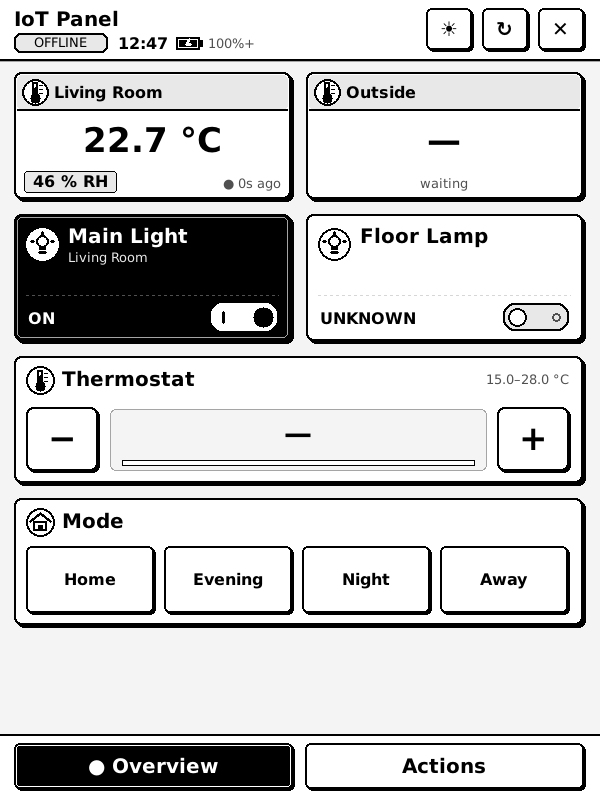
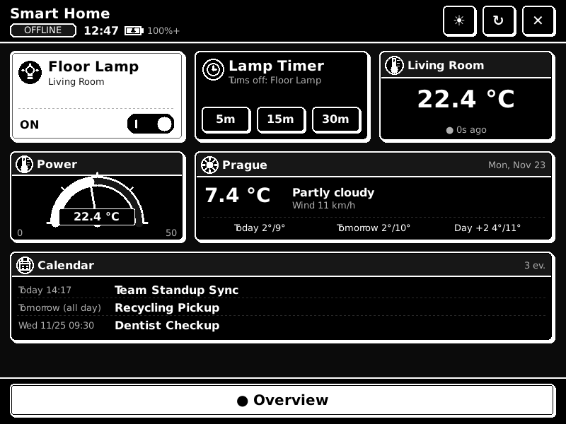
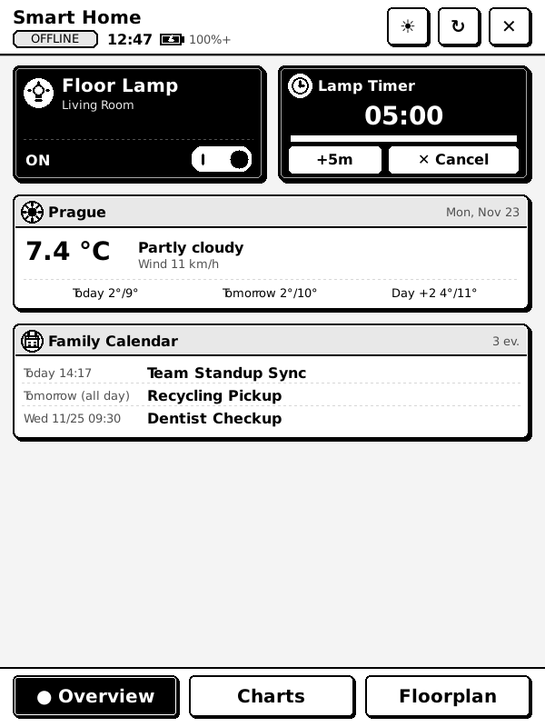
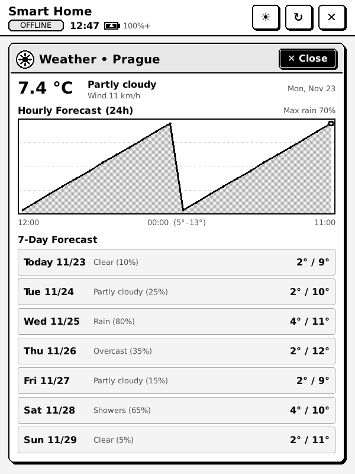
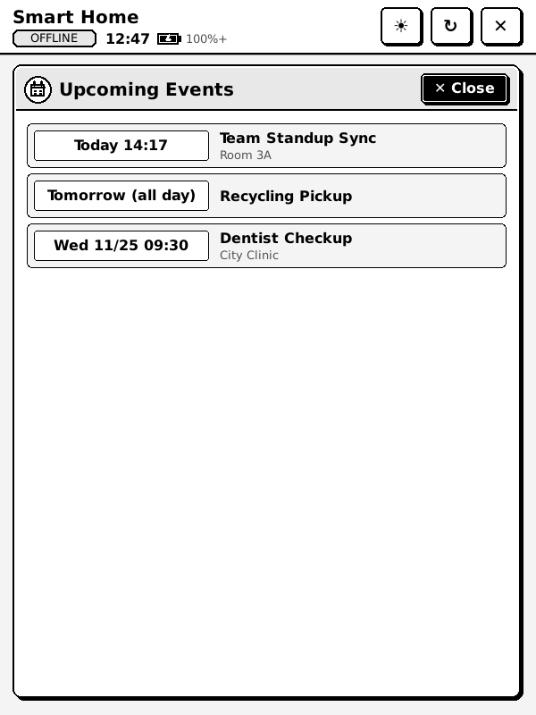
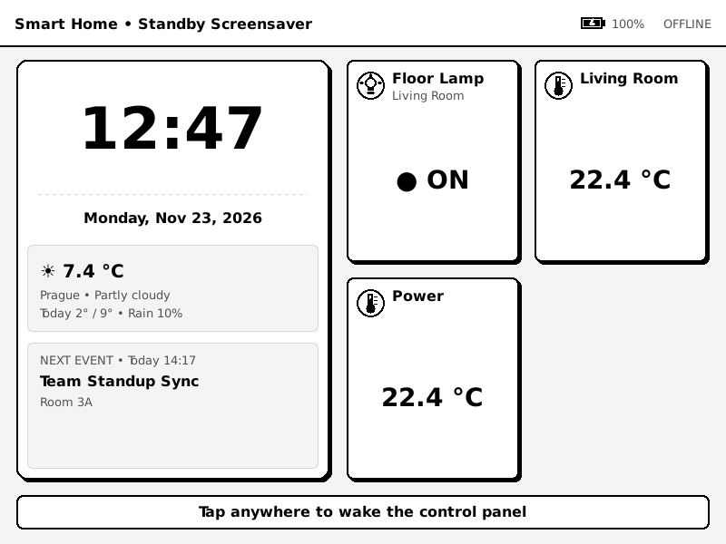
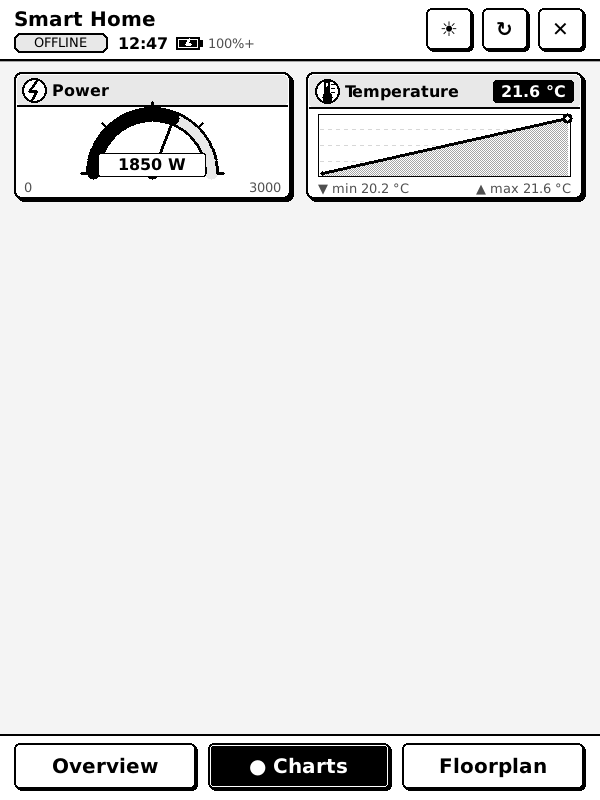
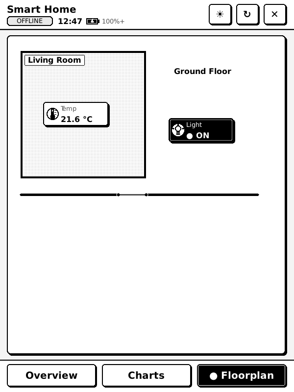
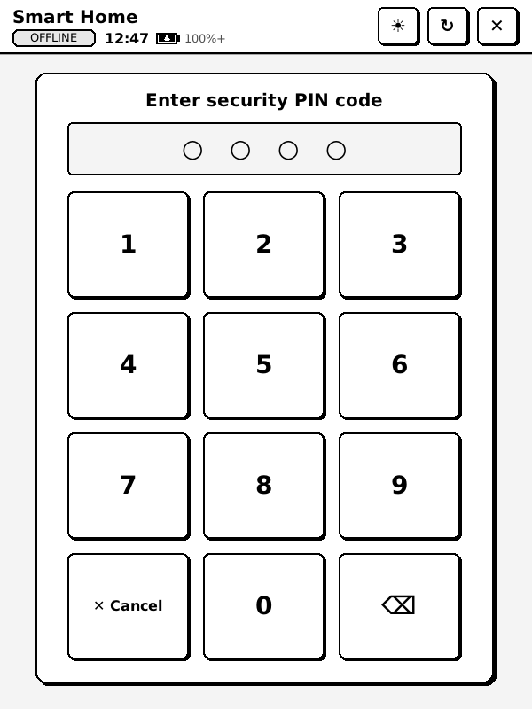

# KindleIOT

**Turn a jailbroken Amazon Kindle into a wall-mounted, zero-dependency e-ink smart-home control panel with native MQTT, Apple HomeKit, weather, iCal calendar, timers, and a visual web configurator.**

[](https://github.com/Chameloun/KindleIOT/actions/workflows/ci.yml)
[](LICENSE)
[](go.mod)
[](docs/DEPLOYMENT.md)

[🇬🇧 English](README.md) · [🇨🇿 Česky](README.cs.md)

---

## Screenshots

| Portrait Dashboard | Landscape Dark Mode (3 Columns) | Timer & Calendar Cards |
| :---: | :---: | :---: |
|  |  |  |

| 7-Day & 24h Weather Detail | iCal Events Detail | Landscape Standby Screensaver |
| :---: | :---: | :---: |
|  |  |  |

| Gauges & Sparkline Charts | Interactive Floorplan | PIN Lock Keypad |
| :---: | :---: | :---: |
|  |  |  |

---

## Key Features

- **Single Static Go Binary (`CGO_ENABLED=0`, `armhf`)** — No GTK, Qt, Python, or external libraries required. Draws directly onto the Kindle Awesome WM X11 framebuffer (`600×800` portrait or rotated `800×600` landscape) with crisp e-ink contrast, 2×2 ordered dithering, and periodic full-black/white flashing to eliminate ghosting.
- **Full English & Czech (`en` / `cs`) Localization** — Both the Kindle e-ink display UI (status bar, modals, weather WMO codes, calendar dates, timers, standby, PIN lock, alerts) and the embedded Web Configurator (`:8080`) support English (`en`, default) and Czech (`cs`) via `device.language` or the live `EN | CZ` header switcher.
- **Universal Multi-Broker MQTT Client** — Supports plain (`tcp://`, `mqtt://`) and TLS (`ssl://`, `mqtts://`, `wss://`, HiveMQ Cloud) with an embedded Mozilla root CA bundle, LWT (`<base_topic>/status`), automatic reconnection, JSONPath value extraction (`$.temperature`, `$.state`, `$.readings[0].val`), and optional **Home Assistant MQTT Discovery**.
- **Built-in Apple HomeKit Bridge (HAP)** — Selectively expose switches (`lightbulb`, `switch`, `outlet`) and temperature sensors/gauges directly into the Apple Home app over Wi-Fi (`udp/5353` mDNS + `tcp/51827`), even without an external MQTT broker (`local/switch/<id>`).
- **10 Widget Types & Architectural Floorplans** — `switch`, `button` (single command or multi-step `macro_actions` scenes, optional 2-tap confirmation), `stepper` (`−` / `+` with `command_template`), `sensor` (primary + secondary reading, value mapping, min/max alert thresholds, stale indicator), `gauge`, `chart` (history sparkline), `select`, `weather`, `timer`, and `calendar`, plus free-form `floorplan` pages with rooms, walls, doors, labels, and interactive device pins.
- **Open-Meteo Weather & iCal (`.ics`) Calendar** — API-key-free weather card with automatic Czech namedays when `language: cs` and a tap-to-open modal featuring a 24-hour curve + 7-day forecast; iCal / Google Calendar / Apple iCloud (`webcal://`) feed parser with `FREQ=WEEKLY` & `FREQ=YEARLY` recurrences.
- **Countdown Timers & Daily Schedules** — Tap presets (`5m / 15m / 30m`, `+5m`, cancel) to automatically switch devices or publish MQTT topics on expiry, plus recurring `HH:MM` weekday automation rules evaluated directly on the Kindle.
- **Power, Night & Security Features** — Configurable backlight auto-dim timeout (`backlight_timeout_sec`), night brightness window (`night_mode_enabled`), standby clock & sensor summary screen (`standby_timeout_sec`), Light / Dark / Auto-Night e-ink themes (`theme_mode`), limit alerts that wake the display, and a 4–8 digit PIN child lock (`pin_code`).
- **Built-in Web Visual Designer & Live Mirror (`:8080`)** — Drag-and-drop grid & floorplan builder, live clickable Kindle screen mirror (`/api/screen.png`), live MQTT topic inspector, schedule & HomeKit manager, and YAML editor accessible from any browser on your LAN.

---

## Quick Start

### Option A: Prebuilt Release for Jailbroken Kindle
1. Ensure your Kindle is jailbroken with **KPM / Scriptlets (`hdnext`)** (tested on **Kindle 10th Gen / KT4**, firmware `5.18.1.1.1`). See [Deployment Guide](docs/DEPLOYMENT.md) for full details.
2. Download `kindleiot-*-kindle-armhf.zip` from [GitHub Releases](https://github.com/Chameloun/KindleIOT/releases).
3. Connect the Kindle over USB and extract the archive into the root of the Kindle USB drive so it creates:
   - `kindleiot/kindleiot-arm`
   - `kindleiot/start.sh`
   - Copy `kindleiot/config.example.yaml` to `kindleiot/config.yaml` and edit your `mqtt.broker` or settings (or configure later in the browser).
   - `documents/KindleIOT.sh`
4. Safely eject USB, open the Kindle Library, and tap **KindleIOT**.
5. Open `http://<KINDLE-IP>:8080` in a browser on the same Wi-Fi network to visually customize pages, HomeKit accessories, weather, calendar, and schedules.

### Option B: Build & Deploy via USB from Source
```bash
git clone https://github.com/Chameloun/KindleIOT.git
cd KindleIOT

# Build ARMv7 binary and deploy onto mounted USB Kindle (/run/media/$USER/Kindle)
make deploy-usb
```

### Option C: Local Preview on Desktop (No Kindle Required)
```bash
cp config.example.yaml config.yaml
make build-local

# Run in headless mode (web simulator & builder at http://localhost:8080)
./kindleiot -config config.yaml -headless

# Or open a desktop X11 window alongside the web UI
./kindleiot -config config.yaml
```

---

## Documentation

- [Installation & Kindle Deployment Guide](docs/DEPLOYMENT.md) — Jailbreak setup, USB deploy, `lipc` / `iptables` / `GODEBUG` runtime details, HomeKit pairing, and troubleshooting.
- [Configuration Reference (`config.yaml`)](docs/CONFIGURATION.md) — Complete schema for brokers, widgets, macros, timers, schedules, iCal feeds, standby, Dark Mode, landscape rotation, alerts, and MQTT telemetry.
- [Architecture & Developer Notes](docs/ARCHITECTURE.md) — System diagram, Go packages, X11 rotation & rendering pipeline, and Web HTTP API endpoints.
- [Contributing Guide](CONTRIBUTING.md) — Running tests, generating PNG previews, and e-ink / font glyph guidelines.
- [Third-Party Notices](THIRD_PARTY_NOTICES.md) — Embedded fonts, root CAs, and Go dependency licenses.

---

## License

Released under the [MIT License](LICENSE).
