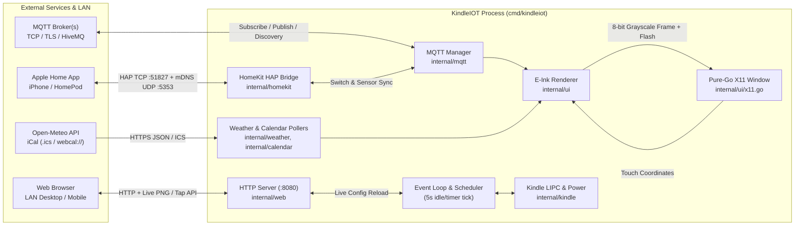

# Architecture Overview

KindleIOT is designed as a single-process, zero-CGO Go daemon combining UI rendering, hardware integration, automation scheduling, MQTT messaging, Apple HomeKit bridging, external pollers, and an HTTP web configurator.

## High-Level System Diagram

---

## Package Structure

| Package | Responsibility |
| :--- | :--- |
| [`cmd/kindleiot`](../cmd/kindleiot/main.go) | CLI flags (`-config`, `-headless`, `-fullscreen`), service lifecycle, 150ms coalesced redraw loop, 5s idle/backlight/standby/timer/schedule ticker, 30s clock refresh, and telemetry publisher. |
| [`internal/config`](../internal/config/config.go) | YAML parsing/saving (`gopkg.in/yaml.v3`), defaults & validation (`NormalizeAndValidate`), logical orientation sizing (`LogicalSize`), night hour helpers, and per-broker topic grouping. |
| [`internal/mqtt`](../internal/mqtt/) | Multi-broker connection pool (`Manager`), TLS with embedded Mozilla CAs (`certs.go`), Paho reconnect/LWT loop, JSONPath extraction (`ExtractValue`), 120-point numeric history buffer (`GetHistory`), and Home Assistant MQTT Discovery. |
| [`internal/homekit`](../internal/homekit/bridge.go) | Pure-Go Apple HomeKit bridge using `github.com/brutella/hap`, persistent pairing & virtual switch state store (`homekit-db/`), and bidirectional sync with Kindle UI / macros / timers / schedules. |
| [`internal/calendar`](../internal/calendar/calendar.go) | RFC 5545 `.ics` / `webcal://` parser (`ParseICS` supporting unfolding, escaping, `VALUE=DATE`, UTC/TZID, `FREQ=WEEKLY` & `FREQ=YEARLY` `RRULE`s) and background 15-minute polling `Service`. |
| [`internal/weather`](../internal/weather/weather.go) | Open-Meteo 7-day + 24h hourly poller (every 30m) mapping WMO codes to Czech weather descriptions and icon keys. |
| [`internal/ui`](../internal/ui/) | Embedded DejaVu Sans fonts (`fonts.go`), vector shapes/icons/dithering (`graphics.go`), Czech namedays (`namedays.go`), stateful e-ink dashboard renderer (`renderer.go`), and pure-Go X11 MIT-SHM/PutImage + software orientation transform (`x11.go`). |
| [`internal/web`](../internal/web/server.go) | Embedded single-page visual drag-and-drop builder, floorplan canvas editor, MQTT topic inspector, schedule manager, and live mirror (`static/index.html`). |
| [`internal/kindle`](../internal/kindle/system.go) | Device detection (`/etc/prettyversion.txt` + `lipc-get-prop`), `lipc-set-prop` frontlight & sleep inhibitor, Wi-Fi keepalive, battery/IP sysfs telemetry, and runtime `iptables` port opening. |

---

## E-Ink Rendering & Orientation Pipeline

1. **Logical Canvas (`internal/ui/renderer.go`):**
   - `Renderer.Render()` renders into an 8-bit `image.Gray` buffer sized via `cfg.Device.LogicalSize()`: `600×800` for `portrait` or `800×600` for `landscape` / `landscape_cw`.
   - Every drawn card, button, modal, and keypad button registers its bounding box in `r.hits` (`[]HitAction`) during rendering so tap hit-testing always matches the exact displayed geometry.
   - If Dark Mode is active (`theme_mode: dark`, `auto_night` during night hours, or user session override `◐`), `finishFrame()` inverts every grayscale pixel (`255 - Y`) at the end of `Render()`.
   - Anti-ghosting full flashes (`xwin.FlashAndDraw`) trigger every `full_refresh_every` redraws, when an active modal closes, on wake/alert, or when manually requested.

2. **Hardware Rotation (`internal/ui/x11.go`):**
   - Physical Kindle KT4 X11 displays always run in `600×800` portrait orientation.
   - When `orientation` is `landscape` (90° CCW) or `landscape_cw` (90° CW), `RotateGrayForDisplay` rotates the `800×600` logical canvas into the `600×800` X11 framebuffer, and `TransformTapFromDisplay` maps incoming X11 pointer coordinates back into logical `(800×600)` space.

---

## Embedded Web Server HTTP API

Served on `web.listen` (default `:8080`) by [`internal/web/server.go`](../internal/web/server.go):

| Endpoint | Method | Description |
| :--- | :--- | :--- |
| `/` | `GET` | Serves the single-page visual configurator (`static/index.html`) from `embed.FS`. |
| `/api/screen.png` | `GET` | Encodes and returns the latest rendered `image.Gray` framebuffer as PNG. |
| `/api/tap` | `POST` | JSON `{"x": int, "y": int}` forwards a simulated touch event into `renderer.HandleTap(x, y)`. |
| `/api/status` | `GET` | Returns Kindle hardware status, MQTT multi-broker snapshot + live topics, and HomeKit pairing/accessory status. |
| `/api/config` | `GET` / `POST` | Reads raw `config.yaml` or validates & reloads either raw YAML (`text/plain`) or JSON `{"yaml": "..."}`. |
| `/api/config/json` | `GET` / `POST` | Reads or saves normalized JSON `config.Config`, writes `config.yaml`, and triggers live reload (`Hooks.ReloadConfig`). |
| `/api/homekit/reset` | `POST` | Stops the HAP server, deletes pairings in `homekit.store_dir`, and restarts HomeKit cleanly. |
